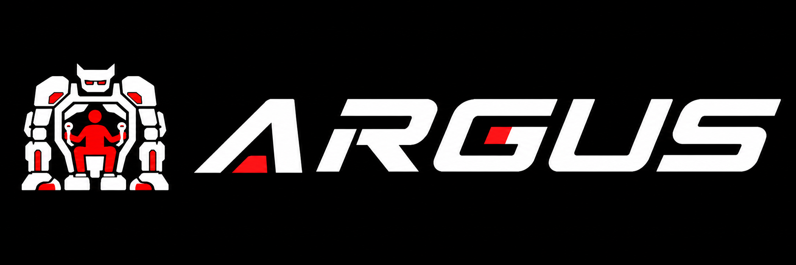
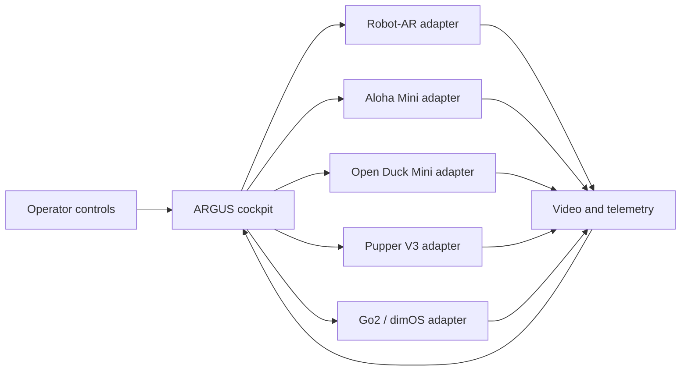

# ARGUS Collaboration

<p align="center">
  
</p>

[](https://github.com/Kelvinchan324/ARGUS-collaboration/actions/workflows/pages.yml)

## Open the project website

**[View ARGUS online](https://kelvinchan324.github.io/ARGUS-collaboration/)**

[Open the English ARGUS website](https://kelvinchan324.github.io/ARGUS-collaboration/)

ARGUS is a multi-robot telepresence and control project. The goal is to give
one operator a consistent way to receive video and telemetry, select a robot,
and intervene safely through a modular cockpit. This repository is the public
integration hub for the cockpit, Robot-AR, Aloha Mini, Open Duck Mini, Pupper V3,
and Unitree Go2/dimOS work.

## Start here

### 1. Clone the repository

```bash
git clone https://github.com/Kelvinchan324/ARGUS-collaboration.git
cd ARGUS-collaboration
```

### 2. Choose the part you need

| Goal | Start here | What is currently available |
| --- | --- | --- |
| Understand or present ARGUS | [`docs/`](docs/) | English static project website |
| Work on the shared cockpit | [`cockpit/`](cockpit/) | Cockpit scope and CAD references |
| Explore the working software prototype | [`connected-robots/robot-ar/`](connected-robots/robot-ar/) | Bridge, planner, web controls and tests |
| Add a robot integration | [`connected-robots/`](connected-robots/) | One isolated folder per robot |
| Prepare a supervised demonstration | [`safety/`](safety/) | Public safety overview and checklists |
| Contribute changes | [`CONTRIBUTING.md`](CONTRIBUTING.md) | Branch, testing and pull-request workflow |

The complete [ARGUS Safety Report 2026](docs/ARGUS-Safety-Report-2026.pdf) is
also available as a downloadable PDF.

### 3. Preview the website locally

The public website contains only static HTML, CSS and JavaScript. From the
repository root, run:

```bash
python -m http.server 8000 --directory docs
```

Then visit [http://127.0.0.1:8000/](http://127.0.0.1:8000/). This local preview
is useful when editing; ordinary visitors should use the public website link at
the top of this README.

### 4. Try the Robot-AR software prototype

Robot-AR is the most complete public integration in this repository. On a
Linux/Jetson development computer:

```bash
cd connected-robots/robot-ar
bash scripts/install_deps.sh
bash scripts/run_tests.sh
bash scripts/bringup.sh
```

The bridge binds to `127.0.0.1:8080` by default. Read the
[Robot-AR instructions](connected-robots/robot-ar/README.md) before connecting
real hardware. Never perform first-motion testing without a reachable physical
power cut, low speed limits and a second person observing the robot.

## Understand the repository

```text
ARGUS-collaboration/
├── cockpit/                   Shared operator interface, controls and CAD
├── connected-robots/
│   ├── robot-ar/              Active bridge and planner prototype
│   ├── aloha-mini/            Aloha Mini integration area
│   ├── open-duck-mini/        Open Duck Mini integration area
│   ├── pupper-v3/             Pupper V3 integration area
│   └── unitree-go2/           Go2 and dimOS integration area
├── docs/                      English GitHub Pages website
├── safety/                    Public demonstration safety guidance
├── CONTRIBUTING.md            Contributor workflow
└── PUBLIC_REPOSITORY_SCOPE.md Public/private content rules
```

The cockpit sends common requests such as connect, stop, move, select camera
and read status. Each robot adapter translates only the requests that its
hardware safely supports and returns a clear error for unsupported commands.



Use these placement rules:

- Put reusable operator-interface and communication code in `cockpit/`.
- Put vendor SDK calls and hardware-specific behavior inside that robot's folder.
- Keep third-party projects in their original repositories; record the tested
  link and commit instead of copying the whole project here.
- When a change affects both the cockpit and an adapter, update and test both in
  the same pull request.

## Current integration status

| Platform | Status | Next evidence needed |
| --- | --- | --- |
| Robot-AR | Software bridge and planner prototype imported | Supervised on-robot validation |
| Aloha Mini | Integration area created | Hardware inventory, maintainer and tested upstream commit |
| Open Duck Mini | Integration area created | Runtime, safe-stop behavior and tested commit |
| Pupper V3 | Integration area created; official documentation and upstream code linked | Hardware inventory, maintainer and tested upstream commit |
| Unitree Go2 + dimOS | Integration planned | Record dimOS version and migrate tested ARGUS connection code |
| Cockpit | CAD references and public system description available | Migrate shared application code with repeatable tests |

This table deliberately separates working public code from planned integration.
Do not interpret a folder's presence as proof that its hardware connection has
been completed or safety-validated.

## Website publishing

Changes under `docs/` are deployed automatically by the
[GitHub Pages workflow](.github/workflows/pages.yml) after they reach `main`.
The workflow also requests first-time Pages enablement. English is the default
entry at the project website root. If GitHub prevents automatic
enablement for this account or repository, a repository administrator must open
[Settings → Pages](https://github.com/Kelvinchan324/ARGUS-collaboration/settings/pages),
set **Source** to **GitHub Actions**, and rerun the workflow.

## Safety and public-repository boundaries

Robots can injure people or damage equipment. Test adapters first with mock
drivers, simulation or disabled actuators. Keep one active command source,
timeouts, speed/workspace limits and an accessible emergency stop. Follow the
full [public safety overview](safety/README.md).

Before adding source, documents, CAD or media, read
[`PUBLIC_REPOSITORY_SCOPE.md`](PUBLIC_REPOSITORY_SCOPE.md). Do not commit
passwords, API keys, Wi-Fi details, private addresses, participant records,
customer material, raw interview data or unlicensed third-party files.

## Licensing

No project-wide license has been selected yet. Until the maintainers add one,
the original authors retain all rights to ARGUS-owned material, and every
upstream dependency keeps its own license. Confirm ownership and applicable
university, sponsor, customer, employment and upstream terms before importing
files or reusing this work.
