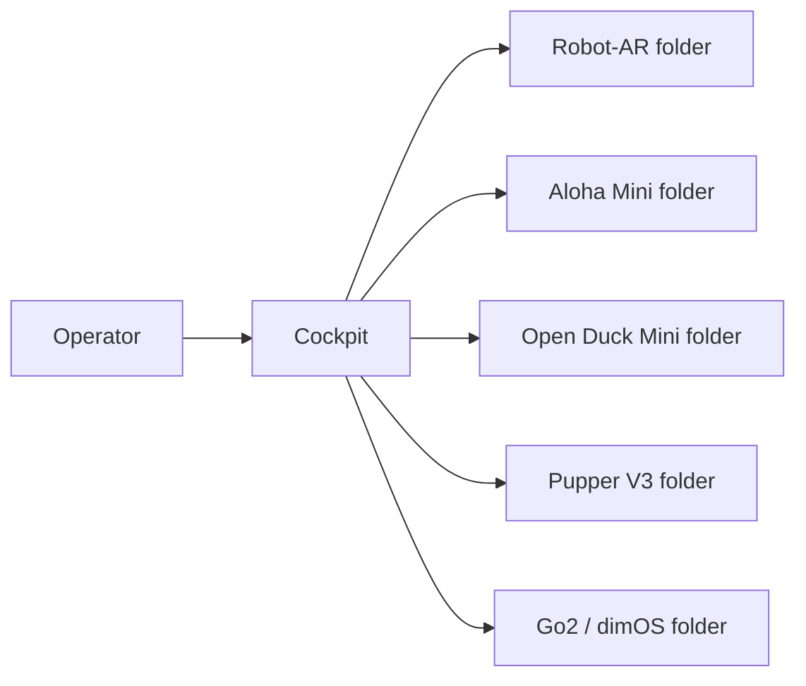

# ARGUS Collaboration

[Project website (繁體中文)](docs/index.html) · [Project website (English)](docs/en/index.html)

## Project website

The bilingual static pitch website lives in [`docs/`](docs/). To publish it
with GitHub Pages, open the repository settings, select **Pages**, choose
**Deploy from a branch**, and use the `main` branch with the `/docs` folder.
The Chinese page is the default entry point and links to the English version.

ARGUS is a multi-robot telepresence and control project. This repository is the
shared integration hub for the cockpit, Robot-AR, Aloha Mini, Open Duck Mini,
Pupper V3, and Unitree Go2 through dimOS.

## Where work goes

```text
ARGUS-collaboration/
├── cockpit/             Shared cockpit application and control code
├── connected-robots/    One folder for each robot
├── CONTRIBUTING.md      How students submit work
└── README.md             Project entry point
```

- Shared cockpit code belongs in [`cockpit/`](cockpit/).
- Robot-dependent code belongs in that robot's folder under
  [`connected-robots/`](connected-robots/).
- A student working on one robot should normally change only that robot folder.

Each robot folder should eventually contain its code, setup instructions,
dependency list, configuration example, and tests. Keeping these items together
makes it easy for a student to understand and maintain one complete integration.

## How the system connects

The cockpit is the shared main application. Each connected robot has a small
robot-specific integration that translates cockpit requests into that robot's
commands and returns telemetry or video.



The working rule is simple:

- If code is shared by multiple robots, put it in `cockpit/`.
- If code depends on one robot, put it in that robot's folder.
- If a change affects both, update both areas in the same pull request and ask
  both maintainers to review it.

The cockpit should send common requests such as connect, stop, move, select
camera, and read status. Each robot folder decides how to perform supported
requests safely. Unsupported requests should return a clear error.

## Connected robots

- [Robot-AR](connected-robots/robot-ar/)
- [Aloha Mini](connected-robots/aloha-mini/)
- [Open Duck Mini](connected-robots/open-duck-mini/)
- [Pupper V3](connected-robots/pupper-v3/)
- [Unitree Go2 with dimOS](connected-robots/unitree-go2/)

The robot folders are currently placeholders. Their maintainers should add only
the ARGUS-specific code they use. Keep full external open-source projects in
their original repositories and link to them from the robot README.

## Moving existing work into the repository

Migrate one working component at a time:

1. Start with the shared cockpit communication and control code. Put it in
   `cockpit/` and add run instructions.
2. Choose the best-tested robot connection. Put only your ARGUS-specific code in
   that robot's folder under `connected-robots/`.
3. Add safe example settings, dependency links, and the exact tested versions to
   that robot's README.
4. Open a pull request and have another person review it before merging.

Do not migrate dependency folders, downloaded open-source projects, ZIP files,
presentations, interviews, customer material, videos, build output, passwords,
API keys, Wi-Fi credentials, or private network addresses.

Large original CAD should be added only when the team confirms ownership and
that it is necessary for building the system. Use Git LFS for approved binary
CAD files.

## Safety

Robots can injure people or damage equipment. Test new integrations in
simulation or with actuators disabled and keep an accessible emergency stop.

### Before power

- [ ] Correct robot, hardware revision, and code version identified
- [ ] Test area clear; robot restrained or lifted when appropriate
- [ ] Emergency stop or physical power disconnect reachable
- [ ] Battery condition confirmed
- [ ] Speed/command limits and timeout configured
- [ ] Only one active command source

### Before motion

- [ ] Robot identity and connection confirmed
- [ ] Telemetry is current
- [ ] Stop tested with actuators disabled or at minimal power
- [ ] Directions checked one axis at a time
- [ ] Operator and observer agree on abort conditions

### After the test

- [ ] Return the robot to a safe state
- [ ] Record code version, result, faults, date, and tester in its README or issue
- [ ] Store large logs and recordings outside Git

Never perform unattended first-motion testing.

## Licensing

No project-wide license has been selected yet. Until the maintainers add one,
the original authors retain all rights to ARGUS-owned material. Every upstream
dependency keeps its own license.

Before importing a file, confirm who created it and whether university, sponsor,
customer, employment, or upstream terms affect ownership. Keep upstream license
notices and links in the relevant robot README.

After a decision, add a root `LICENSE` for ARGUS-owned software and, if needed,
a separate license for original hardware/CAD. This is project organization
guidance, not legal advice.
