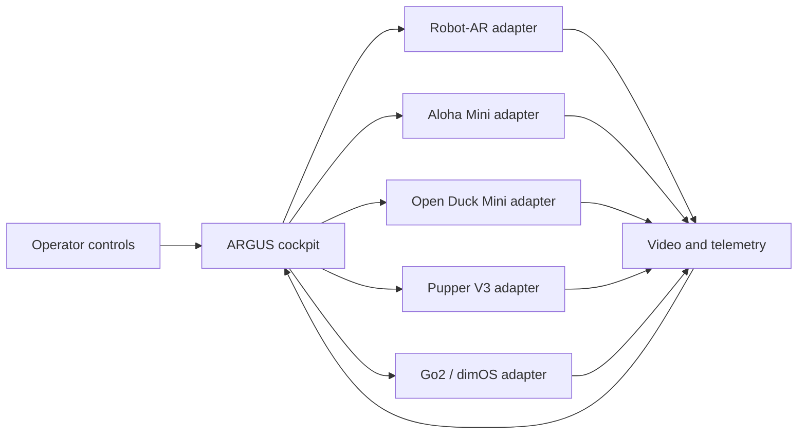

# ARGUS Collaboration

<p align="center">
  
</p>

[](https://github.com/Kelvinchan324/ARGUS-collaboration/actions/workflows/pages.yml)

## Open the project website

**[View ARGUS online](https://kelvinchan324.github.io/ARGUS-collaboration/)**

ARGUS is a supervised multi-robot inspection and telepresence prototype. The
goal is to give one operator a consistent way to receive video and telemetry,
select a robot, and intervene safely through a modular cockpit. This repository
is the public integration hub for the cockpit, Robot-AR, Aloha Mini, Open Duck
Mini, Pupper V3, Bimanual Bunker Mini, and Unitree Go2/dimOS work.

Generated website images are labeled as illustrative concept imagery; they are
not evidence of a field deployment. Integration status and validation limits
come from the repository and its automated tests.

## Start here

### 1. Clone the repository

```bash
git clone https://github.com/Kelvinchan324/ARGUS-collaboration.git
cd ARGUS-collaboration
```

### 2. Choose the part you need

| Goal | Start here | What is currently available |
| --- | --- | --- |
| Understand or present ARGUS | [`docs/`](docs/) | English project website, pilot narrative and safety report |
| Work on the shared cockpit | [`cockpit/`](cockpit/) | Cockpit scope and CAD references |
| Operate the fleet dashboard | [`cockpit/web/`](cockpit/web/) | Six-platform demo, Robot-AR bridge connection, telemetry and base controls |
| Explore the working software prototype | [`connected-robots/robot-ar/`](connected-robots/robot-ar/) | Bridge, planner, web controls and tests |
| Add a robot integration | [`connected-robots/`](connected-robots/) | One isolated folder per robot |
| Prepare a supervised demonstration | [`safety/`](safety/) | Public safety overview and checklists |
| Contribute changes | [`CONTRIBUTING.md`](CONTRIBUTING.md) | Branch, testing and pull-request workflow |

The [draft Info Day 2026 event safety plan](docs/ARGUS-Safety-Report-2026.pdf)
is also available as a downloadable PDF. It describes proposed controls for a
future supervised public demonstration; it is not evidence that the current
hardware configuration has passed those checks.

## Investor interview walkthrough

ARGUS is being tested as a supervised inspection system for commercial and
industrial properties. The current hypothesis is deliberately narrow: one
operator may improve coverage beyond fixed CCTV, reduce repetitive patrol work,
take over when the robot is uncertain, and retain a useful evidence trail.

Use the public materials in this order after completing the interview's initial
problem-discovery questions:

1. Open the website to explain the operator-adaptor-robot loop and the honest
   integration status of each platform.
2. Use the pilot section to discuss one robot, one building and one defined
   route over six to eight weeks.
3. Open the control center in Demo mode to show robot selection, simulated
   telemetry, hold-to-run control, stop behavior and takeover boundaries.
4. Review the Cockpit tab to separate automated software checks from unverified
   physical hardware and site reliability.

The proposed pilot measures patrol effort, useful findings, verification time,
human interventions, route completion and evidence usefulness. ARGUS does not
claim to certify fire-safety or hygiene compliance, replace registered
inspections, or prove hardware readiness through a browser demonstration.

### 3. Preview the website locally

The public website contains only static HTML, CSS and JavaScript. From the
repository root, run:

```bash
python scripts/build_pages.py --output build/pages
python -m http.server 8000 --directory build/pages
```

Use Python 3.11 or newer and a fresh output directory for each build. The build
includes the Bimanual Bunker Mini concept video. The investor-facing website
does not present CAD downloads. Source-referenced visualisation files for Pupper
V3 and Open Duck Mini v2 remain in `docs/cad/` for repository work because their
exact upstream revisions are recorded. Missing robot CAD is deliberately left
absent rather than replaced with approximate geometry.

Then visit [http://127.0.0.1:8000/](http://127.0.0.1:8000/). This local preview
is useful when editing; ordinary visitors should use the public website link at
the top of this README.

### 4. Try the Robot-AR software prototype

Robot-AR is the most complete public integration in this repository. On a
Linux/Jetson development computer:

```bash
cd connected-robots/robot-ar
bash scripts/install_deps.sh
bash scripts/run_tests.sh
bash scripts/bringup.sh
```

The bridge binds to `127.0.0.1:8080` by default. Read the
[Robot-AR instructions](connected-robots/robot-ar/README.md) before connecting
real hardware. Never perform first-motion testing without a reachable physical
power cut, low speed limits and a second person observing the robot.

## Understand the repository

```text
ARGUS-collaboration/
├── cockpit/                   Fleet web dashboard, controls, tests and CAD
├── connected-robots/
│   ├── robot-ar/              Active bridge and planner prototype
│   ├── aloha-mini/            Aloha Mini integration area
│   ├── bimanual-bunker-mini/   Bimanual Bunker Mini concept video and adapter notes
│   ├── open-duck-mini/        Open Duck Mini integration area
│   ├── pupper-v3/             Pupper V3 integration area
│   └── unitree-go2/           Go2 and dimOS integration area
├── docs/                      English website and source-verified visualization STLs
├── safety/                    Public demonstration safety guidance
├── CONTRIBUTING.md            Contributor workflow
└── PUBLIC_REPOSITORY_SCOPE.md Public/private content rules
```

The cockpit sends common requests such as connect, stop, move, select camera
and read status. Each robot adapter translates only the requests that its
hardware safely supports and returns a clear error for unsupported commands.



Use these placement rules:

- Put reusable operator-interface and communication code in `cockpit/`.
- Put vendor SDK calls and hardware-specific behavior inside that robot's folder.
- Keep third-party projects in their original repositories; record the tested
  link and commit instead of copying the whole project here.
- When a change affects both the cockpit and an adapter, update and test both in
  the same pull request.

## Current integration status

| Platform | Status | Next evidence needed |
| --- | --- | --- |
| [Robot-AR](connected-robots/robot-ar/) | Student bridge synced from [`Lycheee-Lychee/ARGUS`](https://github.com/Lycheee-Lychee/ARGUS) at `9c3640c`; four-arm, paired-lift and live-camera support is present in software | Supervised on-robot validation of ports, ranges, lift directions and stop behavior |
| [SO-101 Bimanual](connected-robots/so101/) | ARGUS v1 follower bridge with physical leader teleoperation | Supervised on-robot calibration, mapping and stop validation |
| Aloha Mini | Integration area created | Hardware inventory, maintainer and tested upstream commit |
| [Bimanual Bunker Mini](connected-robots/bimanual-bunker-mini/) | Blender inspection concept video available; no CAD published on the website | Verified source CAD, hardware adaptor, simulator validation and supervised tests |
| Open Duck Mini | Integration area created; source-referenced visualization STLs retained in the repository | Runtime and safe-stop behavior |
| Pupper V3 | Integration area created; source-referenced visualization STLs retained in the repository | Hardware inventory and maintainer |
| Unitree Go2 + dimOS | Integration planned | Record dimOS version and migrate tested ARGUS connection code |
| Cockpit | Six-platform web dashboard; Robot-AR mock bridge and browser tests pass | Supervised hardware validation, operator arbitration and remaining vendor adaptors |

This table deliberately separates working public code from planned integration.
Do not interpret a folder's presence as proof that its hardware connection has
been completed or safety-validated.

For the existing direct SO-101 desktop shortcut flow (leader controller,
follower receiver and camera stream), see [`test-code/`](test-code/). This
legacy test setup is separate from the web cockpit and its ARGUS v1 adapter.

## Website publishing

Changes under `docs/` are deployed automatically by the
[GitHub Pages workflow](.github/workflows/pages.yml) after they reach `main`.
The workflow also requests first-time Pages enablement. English is the default
entry at the project website root. If GitHub prevents automatic
enablement for this account or repository, a repository administrator must open
[Settings → Pages](https://github.com/Kelvinchan324/ARGUS-collaboration/settings/pages),
set **Source** to **GitHub Actions**, and rerun the workflow.

## Safety and public-repository boundaries

Robots can injure people or damage equipment. Test adapters first with mock
drivers, simulation or disabled actuators. Keep one active command source,
timeouts, speed/workspace limits and an accessible emergency stop. Follow the
full [public safety overview](safety/README.md).

Before adding source, documents, CAD or media, read
[`PUBLIC_REPOSITORY_SCOPE.md`](PUBLIC_REPOSITORY_SCOPE.md). Do not commit
passwords, API keys, Wi-Fi details, private addresses, participant records,
customer material, raw interview data or unlicensed third-party files.

## Licensing

No project-wide license has been selected yet. Until the maintainers add one,
the original authors retain all rights to ARGUS-owned material, and every
upstream dependency keeps its own license. Confirm ownership and applicable
university, sponsor, customer, employment and upstream terms before importing
files or reusing this work.
