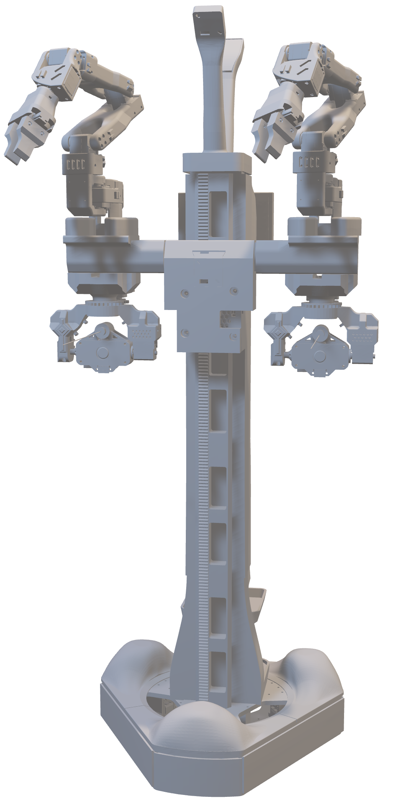

# Robot-AR Adapter

  

> Project-owned Robot-AR concept render. Replace it with a current hardware
> photograph when the physical platform is ready for documentation.

Status: inventory needed.

Robot-AR is the large ARGUS mobile/telepresence robot. Document the current
control computer, transport, command set, sensors, stop path, and authoritative
local source before migrating control code here.
