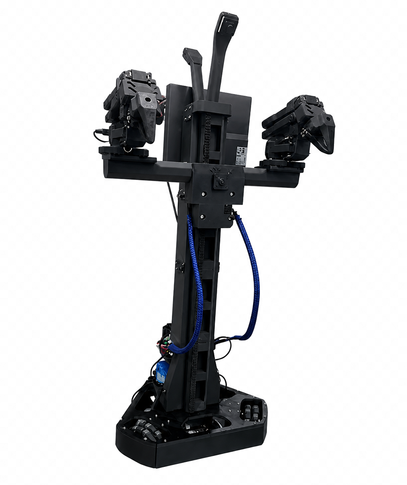

# Aloha Mini

> [Open the ARGUS website](https://kelvinchan324.github.io/ARGUS-collaboration/) · [English](https://kelvinchan324.github.io/ARGUS-collaboration/en/)

<p align="center">
  
</p>

> ARGUS Robot 1 prototype. Upstream project: [liyiteng/AlohaMini](https://github.com/liyiteng/AlohaMini).

- Student maintainer: To be assigned
- Status: SO-101 bimanual host and camera-streaming prototype added; not yet validated on another device
- Tested upstream version/commit: To be recorded

## Raspberry Pi SO-101 host

The files in this folder include the SO-101 bimanual host and MJPEG camera
streamer currently launched from the local Raspberry Pi desktop shortcut. The
`Aloha-Mini-SO101-Host.desktop` shortcut is included for copying to a new Pi's
Desktop. It expects this repository at `~/ARGUS-collaboration`; if you cloned
the repository elsewhere, update the `Exec` path in the shortcut before use.
After copying it, mark the shortcut executable and trusted if the desktop
environment prompts you.

The host requires a compatible LeRobot checkout and Python environment with
LeRobot, `pyzmq`, and OpenCV installed. By default, the launcher looks for
`~/Robot/lerobot` and its `.venv` or `venv`; set `LEROBOT_ROOT` or
`LEROBOT_PYTHON` when your checkout or environment is elsewhere:

```bash
export LEROBOT_ROOT="$HOME/Robot/lerobot"
bash connected-robots/aloha-mini/run_so101_bimanual_host.sh
```

Before starting, confirm that the two follower arms are connected to the
expected serial ports (`/dev/ttyACM0` and `/dev/ttyACM1`) and that the robot is
clear to move. The host connects to both arms and accepts commands on TCP ports
5555 and 5556; the camera stream is served on port 8000, normally at
`http://<robot-ip>:8000/`. Check the camera index on each device before use.

These services bind to all network interfaces and do not authenticate clients.
Use them only on a trusted, isolated LAN; do not expose their ports to the
internet. This host uses a ZMQ JSON action protocol and is not yet connected to
the ARGUS cockpit's common adaptor/receiver interface. Hardware operation and
cross-device setup have not been verified by this repository.

Only the runtime host and camera-streaming modules are copied here. Machine
logs, calibration files, desktop shortcuts, experimental scripts, and bundled
vendor reference code remain on the source device.
