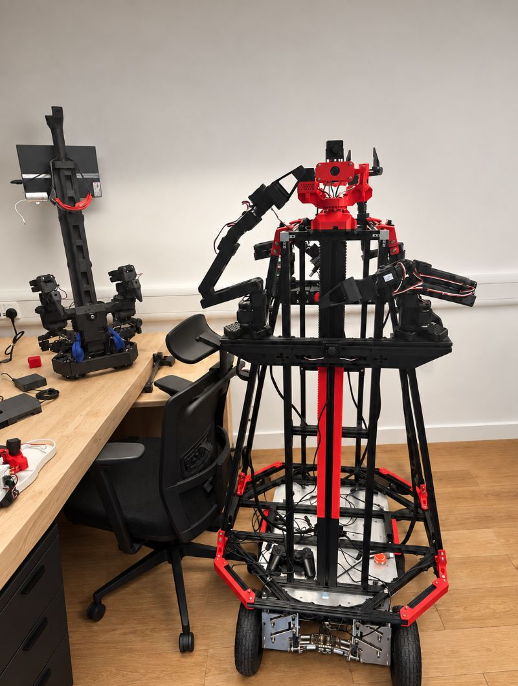

# Robot-AR

> [Open the ARGUS website](https://kelvinchan324.github.io/ARGUS-collaboration/) · [English](https://kelvinchan324.github.io/ARGUS-collaboration/en/)

<p align="center">
  
</p>

> Robot-AR prototype photographed for ARGUS Report Back Session 1. Robot-AR is
> the team's large bimanual mobile robot; it is separate from Aloha Mini.

Robot-AR is the large ARGUS mobile-manipulation research platform: a
four-wheel-steer chassis, two SO-ARM100/101 arms, Robonine parallel grippers,
and an NVIDIA Jetson Thor control computer. This folder contains the student's
ARGUS-specific bridge, web teleoperation UI, command planner, configuration,
tests, and integration documentation.

## Ownership and import record

- Student maintainer: [Lycheee-Lychee](https://github.com/Lycheee-Lychee)
- Upstream repository: [Lycheee-Lychee/ARGUS](https://github.com/Lycheee-Lychee/ARGUS)
- Imported upstream commit: `de276622567aaca2de8fad79aae158fc5749b71a`
- Import date: 2026-10-04
- Current status: software bridge and planner prototype; hardware-dependent
  functions still require on-robot validation

The upstream `vendor/` directory was deliberately not copied. It contains
complete firmware and ROS2 source trees that should remain in their original
repository until ownership, licensing, provenance, and the exact required
files are confirmed. Keep this folder focused on ARGUS-owned integration code.

## Current software

| Path | Role |
| --- | --- |
| `robot_bridge/` | FastAPI bridge, web teleoperation UI, chassis and arm adapters |
| `agent/` | Rule-based and optional local/cloud language planner |
| `config/ports.yaml` | Example SO-101 serial-port mapping |
| `docs/` | Architecture, emergency-stop and task-readiness notes |
| `scripts/` | Dependency setup, bring-up, calibration and test helpers |
| `sim/` | Placeholder for optional SO-ARM simulation work |

The bridge keeps hardware access behind one HTTP boundary. Agents must not
open serial devices or call the arm driver directly.

## Quick start on the robot computer

From this folder:

```bash
bash scripts/install_deps.sh
bash scripts/run_tests.sh
bash scripts/bringup.sh
```

The safe default binds the bridge to `127.0.0.1:8080`. For remote development,
use an SSH tunnel. Do not expose the unauthenticated bridge to the public
internet or a shared campus network. An explicitly isolated laboratory network
may use `HOST=0.0.0.0 bash scripts/bringup.sh` only after a physical emergency
stop, firewall rules, speed limits, command timeout and a test observer are in
place.

## Implemented and planned capabilities

- Implemented in software: mock chassis, command parser, web controls,
  `/stop`, command timeout, arm-adapter slots and planner tests.
- Hardware dependent: chassis serial control, SO-101 connection and calibration.
- Not yet wired: camera perception and `vla_act` visual manipulation.
- Refused until wired and validated: open-door, pick-and-place and search tasks.

## Safety

`POST /stop` cancels the current task, stops and disables the chassis, and
disconnects the arm buses. It is not a substitute for a reachable physical
power cut. Complete the parent repository's pre-power and pre-motion checklist
before enabling hardware.

## Configuration and secrets

Copy `.env.example` to an untracked `.env` only on the robot computer. Never
commit API keys, Wi-Fi credentials, private IP addresses, calibration data tied
to a specific unsafe setup, or customer/network information.

## Licensing

No project-wide ARGUS license has been selected. The student retains rights to
their original work unless separately agreed. Every external dependency and
hardware project keeps its own license. Confirm licensing before redistributing
or importing any omitted vendor source.
