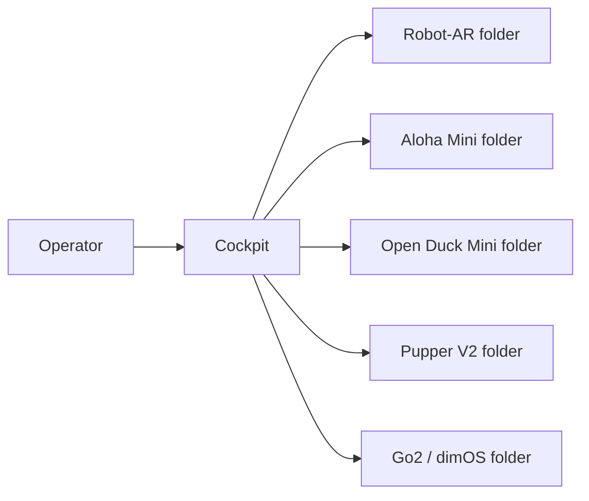

# Simple System Layout

The cockpit is the shared main application. Each connected robot has a small
robot-specific integration that translates cockpit requests into that robot's
own commands and returns telemetry or video.

## Simple rule

- If code is shared by multiple robots, put it in `cockpit/`.
- If code depends on one robot, put it in that robot's folder.
- If a change affects both, update both areas in the same pull request and ask
  both maintainers to review it.

The cockpit should send common requests such as connect, stop, move, select
camera, and read status. Each robot folder decides how to perform supported
requests safely. Unsupported requests should return a clear error rather than
being guessed.
