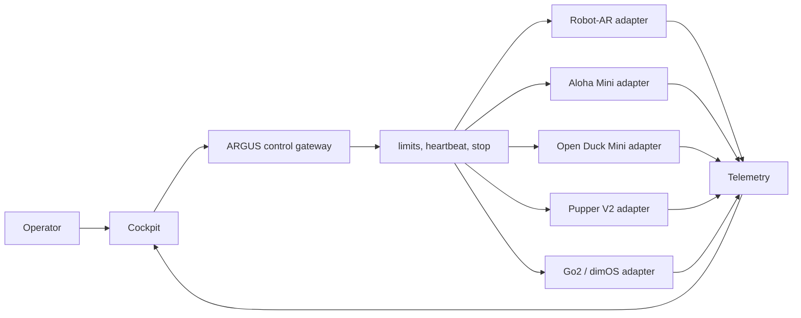

# System Architecture

ARGUS separates operator intent from robot-specific control. The cockpit emits a
small, versioned command contract; each adapter translates it into the native
API of one robot. Telemetry returns through the same boundary.

## Design rules

1. The cockpit must not import a vendor SDK directly.
2. Every robot declares capabilities; unsupported commands fail safely.
3. Motion commands expire unless refreshed by a heartbeat.
4. Stop is local, high priority, and independent of cloud services.
5. Configuration examples contain placeholders; deployed secrets stay outside Git.
6. Adapter behavior is testable with replay or simulation before physical use.

## Ownership boundary

This repository owns the gateway, stable interfaces, ARGUS-specific adapters,
tests, configuration templates, cockpit integration, and operating documentation.
CAD and code copied unchanged from external projects remain upstream. See
[ADR-0001](../decisions/0001-integration-hub.md).
